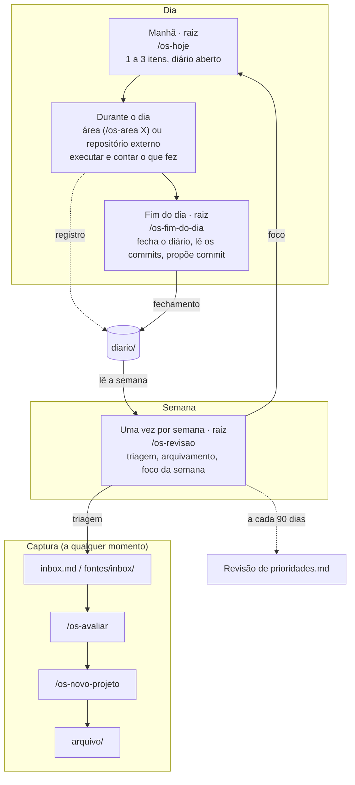

# myos

Um assistente pessoal para acompanhar projetos, pendências, ideias e estudos, organizado por áreas. Funciona com o [Claude Code](https://claude.com/claude-code) e com os agentes do Google ([Antigravity](https://antigravity.google) e [Gemini CLI](https://geminicli.com)). Tudo fica em arquivos Markdown nesta pasta; o agente lê e escreve esses arquivos seguindo as regras do [AGENTS.md](AGENTS.md).

A organização segue o método **PARA**: uma **área** é uma responsabilidade contínua (saúde, carreira, família...); um **projeto** tem objetivo e termina, e pertence a uma área.

## Comece aqui

1. **Crie o seu repositório a partir deste template**, de preferência **privado**: ele vai guardar informação pessoal.
2. **Abra a pasta no seu agente** e digite `/os-onboarding` (no Gemini CLI, peça "roda o os-onboarding"). O agente apresenta o sistema e conversa com você para preencher as [prioridades](prioridades.md) (valores, prioridades do momento e tempo disponível), criar as suas áreas a partir de [areas/_modelo/](areas/_modelo/) e registrar os primeiros projetos. Ele roda uma vez só: ao final, cria o arquivo `.onboarding-concluido`, que impede uma nova execução.
3. **Depois**, use `/os-novo-projeto` para projetos novos e jogue ideias soltas em [inbox.md](inbox.md).
4. **No dia a dia**, use `/os-hoje` de manhã e `/os-fim-do-dia` ao encerrar.
5. **Uma vez por semana**, rode `/os-revisao`.

Se quiser, ajuste o [AGENTS.md](AGENTS.md) ao seu jeito: o papel do assistente, o idioma e as convenções.

## Como usar

- **Raiz (`myos/`)**: o padrão. Planejar e fechar o dia, revisar a semana, ingerir fontes, avaliar ideias e criar projetos. Todos os comandos rodam aqui.
- **Área (`areas/<nome>/`)**: para sessões de trabalho focado (currículo, estudo, planejar uma viagem), com o papel do assistente naquela área. Lá, o que você contar é registrado no diário e as ideias novas vão para a inbox. O único comando é o `/os-area`, para trocar de área ou voltar à raiz.

```
/os-area <nome>     # abre a área numa nova janela do editor
/os-area raiz       # volta para a visão global
```

Não precisa de comando para tudo: "anota que preciso...", "o que falta no projeto X?" ou "me ajuda com o currículo" também funcionam.

## Workflow



| Quando | Onde | O que fazer |
|---|---|---|
| Manhã | Raiz | `/os-hoje`: escolher de 1 a 3 itens e abrir o diário |
| Durante o dia | Área ou repositório externo | Executar. Contar o que foi feito, decidido ou descoberto ("terminei X") para ir ao diário |
| Fim do dia | Raiz | `/os-fim-do-dia`: fechar o diário, registrar conquistas e fazer o commit do myos |
| Uma vez por semana (ex.: domingo) | Raiz | `/os-revisao`: progresso, triagem da inbox e de `fontes/inbox/`, arquivamento, foco da semana |
| A cada trimestre | Raiz | Revisão de `prioridades.md`, disparada pelo `/os-revisao` |

### Onde anotar o quê

| O que surgiu | Destino | Como |
|---|---|---|
| Algo feito, decidido ou descoberto | `diario/` (e `[x]` no item) | "terminei...", "decidi..." (de qualquer lugar) |
| Pendência avulsa | `areas/<area>/tarefas.md` | "anota que preciso..." |
| Ideia ou possível projeto | `inbox.md` | "anota essa ideia..."; decidir depois com `/os-avaliar` |
| Material para ler (chat, transcrição, documento) | `fontes/inbox/` | Salvar o arquivo lá e rodar `/os-ingerir` |
| Trabalho técnico de um projeto com repositório | O próprio repositório | Os commits são lidos pelo `/os-fim-do-dia` e pelo `/os-revisao` |

Todos rodam só na raiz, exceto o `/os-area`.

| Comando | O que faz |
|---|---|
| `/os-onboarding` | Primeiro uso: apresenta o sistema, preenche as prioridades e cria as áreas (roda uma vez só) |
| `/os-configurar` | Cria áreas novas, revisa as prioridades ou liga um repositório externo |
| `/os-novo-projeto` | Cria um projeto com objetivo e próximos passos |
| `/os-avaliar` | Ajuda a decidir se uma ideia vale a pena agora, depois ou nunca |
| `/os-hoje` | Escolhe de 1 a 3 coisas para o dia e abre o diário |
| `/os-fim-do-dia` | Fecha o dia: o que foi feito, o que fica para amanhã e conquistas |
| `/os-revisao` | Revisa o andamento, faz a triagem da inbox, arquiva o que terminou e registra em `reviews/` |
| `/os-ingerir` | Lê um arquivo de `fontes/inbox/`, arquiva o original e grava o conteúdo na área certa |
| `/os-area <nome>` | Troca de área: abre a pasta numa nova janela do VS Code, com conversa limpa |

## Estrutura

| Onde | O quê |
|---|---|
| `.onboarding-concluido` | Flag criada ao fim do `/os-onboarding`; não apague |
| [prioridades.md](prioridades.md) | Valores, prioridades do momento e capacidade semanal |
| [projetos/](projetos/) | Um arquivo por projeto, com a área a que pertence: objetivo, próximos passos, pendências e registro |
| `areas/<area>/AGENTS.md` | Contexto da área, o papel do assistente nela e os recorrentes (hábitos, datas fixas) |
| `areas/<area>/tarefas.md` | Pendências avulsas da área |
| `areas/<area>/ideias/` | Ideias pensadas, inclusive as descartadas |
| `areas/<area>/notes/` | Referências, listas de estudo, currículo, anotações |
| [areas/_modelo/](areas/_modelo/) | Modelo usado para criar áreas novas |
| [arquivo/](arquivo/) | Projetos concluídos ou abandonados |
| [diario/](diario/) | Um arquivo por dia: plano, registro e fechamento |
| [inbox.md](inbox.md) | Ideias e lembretes de uma linha, triados na revisão semanal |
| [fontes/](fontes/) | Arquivos para ler e organizar (chats, transcrições, documentos), processados com `/os-ingerir` |
| [reviews/](reviews/) | Revisões semanais (`AAAA-Www.md`) |
| [templates/](templates/) | Modelos de projeto, ideia, diário, revisão e ficha de fonte |

## Áreas (`areas/`)

| Pasta | Assunto |
|---|---|
| _(criadas pelo `/os-onboarding`)_ | |

## Claude Code e agentes do Google

Os arquivos são os mesmos para todos; nada é duplicado:

| Arquivo | Claude Code | Antigravity / Gemini CLI |
|---|---|---|
| `AGENTS.md` (raiz e áreas) | lido pelo `CLAUDE.md`, que só contém `@AGENTS.md` | lido direto (Gemini CLI via [.gemini/settings.json](.gemini/settings.json)) |
| `.agents/skills/` | lido pelo atalho `.claude/skills` (symlink) | lido direto |
| Comandos | `/os-hoje` | Antigravity: `/os-hoje`; Gemini CLI: "roda o os-hoje" |

Edite sempre o `AGENTS.md` e os arquivos em `.agents/skills/`. No Windows, ative symlinks no git (`git config core.symlinks true`, com o modo desenvolvedor ligado) antes de clonar.

## Projetos com repositório externo

Um projeto pode apontar para outro repositório (campo `repositorio:`, ex.: um software que você desenvolve). O trabalho técnico vive lá; o myos só lê para acompanhar o progresso. Dê acesso a ele no agente: no Claude Code, em `additionalDirectories` de [.claude/settings.json](.claude/settings.json); no Antigravity e no Gemini CLI, como pasta adicional do workspace.

## Privacidade

- Use um repositório **privado**: diário, saúde e carreira são informação pessoal.
- O material bruto de `fontes/inbox/` e `fontes/originais/` fica fora do git (ver [fontes/README.md](fontes/README.md)).
